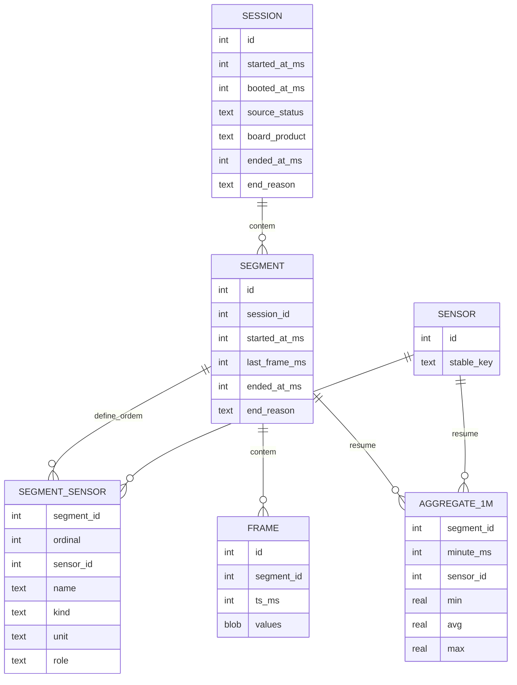
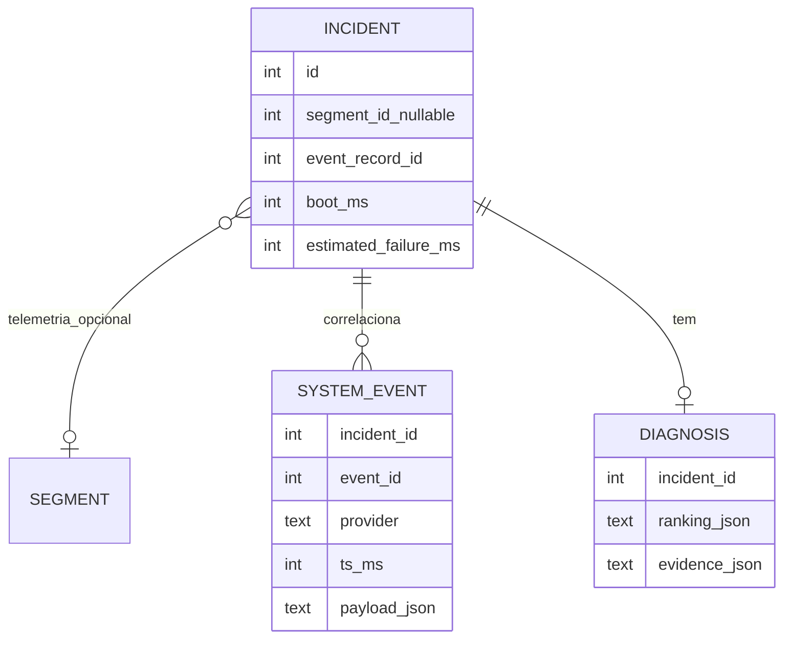

# Modelo de dados

Decisões em [ADR 0004](../adr/0004-sqlite-wal-full-sync-frame-rows.md) e [ADR 0011](../adr/0011-segments-gaps-and-watchdog.md). Schema versionado por `PRAGMA user_version`, scripts em `src/PcMonitor.Infrastructure.Persistence.Sqlite/Migrations/`.

## Implementado ✅ (migrações 001–002)

## Planejado 🕓 (Plano 03)

| Ponto | Decisão |
|---|---|
| Uma linha por instante | `frame.values` é um vetor `float32` little-endian na ordem de `segment_sensor.ordinal`; só o `FrameCodec` conhece o formato. `NaN` = sem valor. |
| Chave do quadro | `rowid`; índice **não único** em `(segment_id, ts_ms)`: quadros com horário repetido ou fora de ordem (ajuste de relógio) são todos mantidos. |
| Sensores | `sensor` guarda só a identidade (`stable_key`, o identificador da LibreHardwareMonitor). Nome, tipo, unidade e papel ficam em `segment_sensor`, **por segmento**: corrigir um perfil de placa depois nunca reescreve o significado do histórico. Os valores gravados já estão multiplicados pelo perfil. |
| Durabilidade | WAL + `synchronous=FULL` + WAL persistente (o painel lê mesmo sem permissão de escrita na pasta). |
| Retenção | Quadros por 14 dias; agregados de 1 min (mín/méd/máx, ignorando `NaN`) para sempre; job a cada 1 h, em transações curtas. |
| Local | `%ProgramData%\PcMonitor\pcmonitor.db`; ACL: SYSTEM e Administradores. |
| Volume esperado | ~15–20 MB/dia no banco; < 1 GB/dia de escrita física. |
