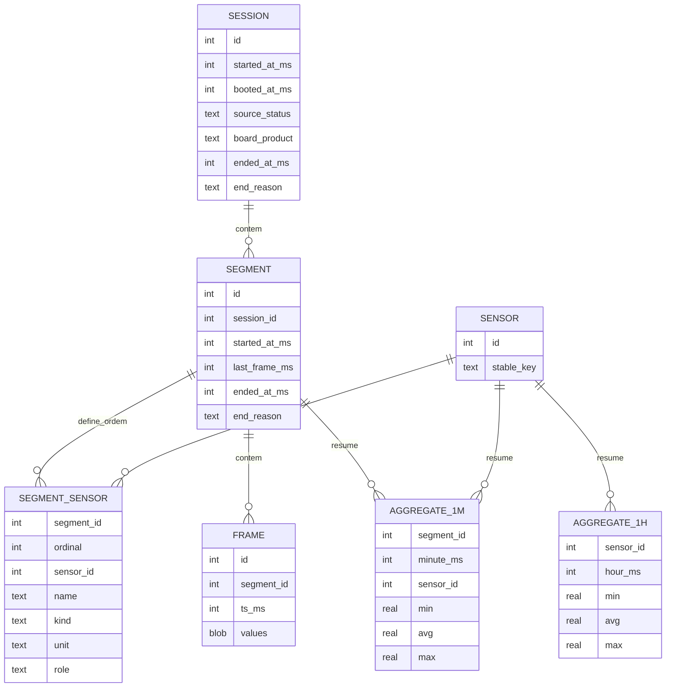
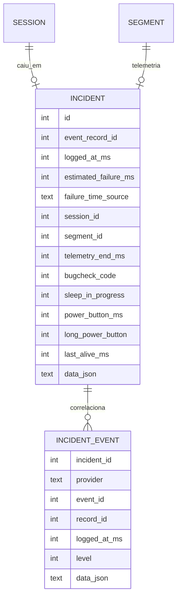
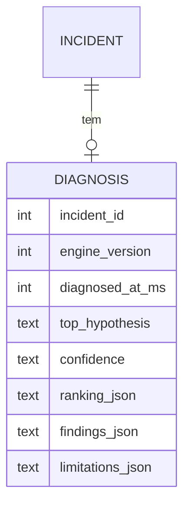

# Modelo de dados

Decisões em [ADR 0004](../adr/0004-sqlite-wal-full-sync-frame-rows.md) e [ADR 0011](../adr/0011-segments-gaps-and-watchdog.md). Schema versionado por `PRAGMA user_version`, scripts em `src/PcMonitor.Infrastructure.Persistence.Sqlite/Migrations/`.

## Implementado ✅ (migrações 001–005)

### Sensores de memória e disco ✅ (sem migração)

Memória e discos entram como sensores comuns: `segment_sensor.kind` ganhou `Level` (vida útil do disco, %) e `role` ganhou `MemoryLoad` (`/ram/load/0`). Dos sensores NVMe o perfil da placa só mantém, por disco N: temperatura (`/nvme/N/temperature/0`), limites de aviso e crítico do próprio disco (`/10`, `/11`), espaço usado (`/nvme/N/load/30`) e vida útil (`/nvme/N/level/20`). O `StorageMeasure` do Domain classifica essas chaves e a API devolve `storage { disk, measure }`; a temperatura de cada disco é colorida pelos limites dele.

### Incidentes ✅ (migrações 003–004)

### Diagnóstico ✅ (migração 005)

`incident.sleep_in_progress` guarda o estado de energia (0, 3 suspensão, 4 hibernação/Fast Startup); a migração 005 recuperou o valor real dos incidentes gravados antes como 0/1.

| Ponto | Decisão |
|---|---|
| Uma linha por instante | `frame.values` é um vetor `float32` little-endian na ordem de `segment_sensor.ordinal`; só o `FrameCodec` conhece o formato. `NaN` = sem valor. |
| Chave do quadro | `rowid`; índice **não único** em `(segment_id, ts_ms)`: quadros com horário repetido ou fora de ordem (ajuste de relógio) são todos mantidos. |
| Sensores | `sensor` guarda só a identidade (`stable_key`, o identificador da LibreHardwareMonitor). Nome, tipo, unidade e papel ficam em `segment_sensor`, **por segmento**: corrigir um perfil de placa depois nunca reescreve o significado do histórico. Os valores gravados já estão multiplicados pelo perfil. |
| Durabilidade | WAL + `synchronous=FULL` + WAL persistente (o painel lê mesmo sem permissão de escrita na pasta). |
| Histórico | O painel lê um sensor por período: índice `ix_aggregate_sensor_minute (sensor_id, minute_ms)` (migração 006); os minutos ainda não agregados são calculados dos quadros, a partir do minuto seguinte ao último agregado do sensor. |
| Retenção | Quadros por 14 dias, **exceto os 120 s antes do fim da telemetria de cada incidente, em qualquer segmento da sessão**; agregados de 1 min (mín/méd/máx, ignorando valores não finitos: `NaN` e infinitos) por 90 dias; resumo por hora e sensor (`aggregate_1h`, migração 007) para sempre. Um minuto só é apagado depois que a hora dele está resumida. Job a cada 1 h, em transações curtas ([ADR 0016](../adr/0016-aggregate-retention.md)). |
| Incidentes | Um por Kernel-Power 41, idempotente por `(event_record_id, logged_at_ms)`; `failure_time_source` diz de onde vem a estimativa. |
| Local | `%ProgramData%\PcMonitor\pcmonitor.db`; ACL: SYSTEM e Administradores com controle total, `NT SERVICE\PcMonitor.Dashboard` só leitura (o painel abre com `Mode=ReadOnly` e nunca migra o schema). |
| Volume esperado (35 sensores) | Quadros ~20 MB/dia, estável em ~280 MB (14 dias); agregados de 1 min ~3,3 MB/dia, estável em ~300 MB (90 dias); resumo por hora ~20 MB/ano. Banco estável perto de 600 MB, crescendo ~20 MB/ano. WAL limitado a 64 MiB (`journal_size_limit`). Escrita física < 1 GB/dia. |
