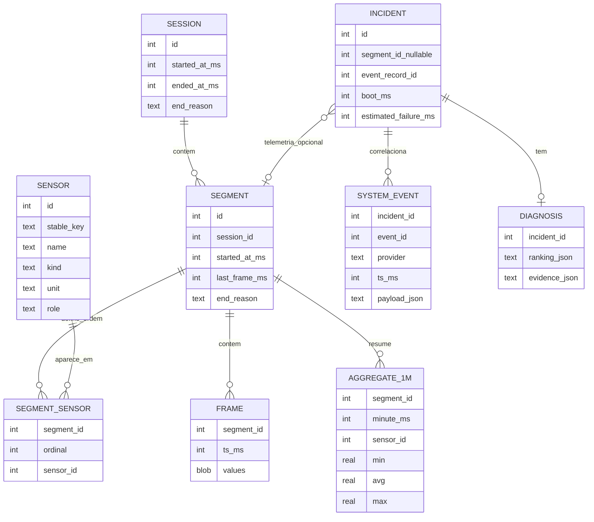

# Modelo de dados

Status: 🕓 planejado (Plano 02). Decisões em [ADR 0004](../adr/0004-sqlite-wal-full-sync-frame-rows.md).

| Ponto | Decisão |
|---|---|
| Uma linha por instante | `FRAME.values` é um vetor `float32` na ordem de `SEGMENT_SENSOR.ordinal`; só o `FrameCodec` conhece o formato |
| Durabilidade | WAL + `synchronous=FULL`; WAL persistente para o painel ler em modo somente leitura |
| Retenção | Quadros por 14 dias; agregados de 1 min para sempre; janelas de incidente nunca apagadas |
| Local | `C:\ProgramData\PcMonitor\pcmonitor.db` |
| Volume esperado | ~15–20 MB/dia no banco; < 1 GB/dia de escrita física |
