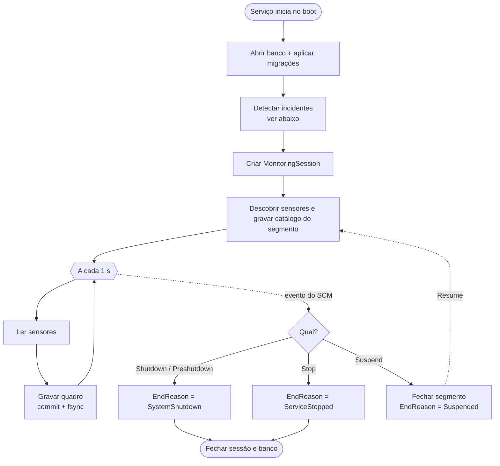
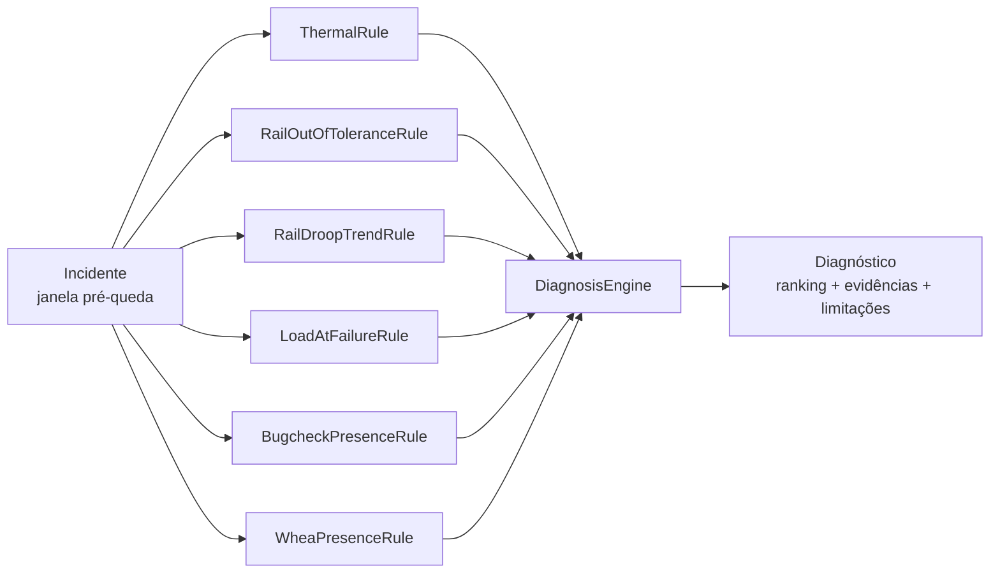
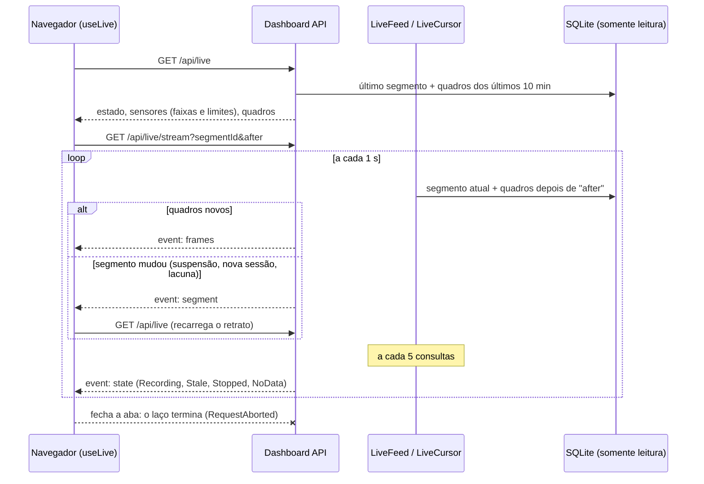
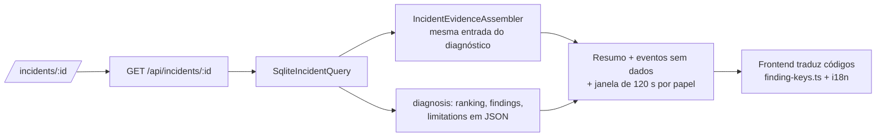

# Fluxos

Status: ciclo do coletor ✅ (Plano 02) · detecção de incidentes ✅ (Plano 03) · diagnóstico ✅ (Plano 04) · painel ✅ (Plano 05).

## Ciclo de vida do coletor e amostragem ✅



- Além dos eventos do SCM, uma lacuna de mais de 3 × o intervalo sem evento de energia fecha o segmento com `Gap` (cobre o *Fast Startup*).
- `PcMonitorServiceLifetime` distingue *stop* de *shutdown* e repassa suspensão/retomada (`OnShutdown`, `OnPowerEvent`).
- **Watchdog:** a leitura roda na thread `PcMonitor.Sampler`. Sem ciclo concluído por 10 s, registra `SamplerStalled` (EventId 1001) e chama `Environment.FailFast`; as ações de recuperação do serviço o reiniciam.
- Decisões: [ADR 0011](../adr/0011-segments-gaps-and-watchdog.md).

## Detecção de incidentes ✅

O **Kernel-Power 41** do Log de Eventos é a fonte de verdade de que a máquina caiu ([ADR 0005](../adr/0005-event-log-as-incident-source-of-truth.md)).


Detalhes da implementação (`DetectIncidents`, executado pelo coletor antes de abrir a sessão nova):

- **Todas as quedas do log são lidas a cada início**, na ordem de registro, e as já salvas são puladas antes da associação. Não há marca d'água por horário: o relógio do boot vem do RTC da placa, que uma placa com defeito pode errar.
- **Sessão da queda:** a sessão aberta mais recente cujo boot (medido pela própria sessão) é anterior ao 41 e não anterior ao boot da queda anterior.
- **Estimativa da queda:** último quadro (`LastFrame`); se a máquina estava entrando/saindo da suspensão, `LastFrameBeforeSleep` (limite inferior); se o Windows ainda estava vivo depois do último quadro, o coletor já tinha parado e vale o 6008 (`LastAliveEventLog`, também limite inferior); sem nada, `Unknown`.
- **6008 de cada queda:** o escrito no mesmo boot, pareado por ordem de registro (fica entre o 41 anterior e o 41 dele), nunca só por proximidade de horário.
- **Eventos relacionados:** de 10 min antes da estimativa (ou 40 min antes do 41, sem estimativa) até 2 min depois do 41, **recortados nas quedas vizinhas**: 6005/6006/6008, 1074/1076, BugCheck 1001, Kernel-Power 41/42/107/109 e WHEA.
- **Atomicidade:** o incidente e o fechamento da sessão que caiu são gravados na mesma transação. Uma queda que falha ao importar não impede as outras e é tentada de novo no próximo início.
- **Retenção:** os 120 s antes do fim da telemetria de cada incidente nunca são apagados, em todos os segmentos da sessão.
- Falha na detecção é registrada (EventId 1201) e a amostragem começa mesmo assim.

## Motor de diagnóstico ✅

Cada regra é uma classe que implementa `IDiagnosticRule` e devolve evidências para uma hipótese; o motor só agrega. Nova regra = nova classe registrada, sem alterar o motor.



Executado pelo coletor ao iniciar, logo após a detecção (`StartupAnalysis`; cada etapa isolada). Regras, códigos, limiares e confiança: [diagnosis.md](diagnosis.md).

## Painel ao vivo ✅

O painel só lê o banco ([ADR 0014](../adr/0014-read-api-sse-and-event-privacy.md)). O navegador pega um retrato dos últimos 10 min e depois recebe os quadros novos por Server-Sent Events.



- `Recording`: sessão aberta e último quadro há no máximo 5 s; `Stale`: sessão aberta sem quadros novos (coletor travado, PC voltando da suspensão ou sem energia); `Stopped`: sessão encerrada; `NoData`: nada gravado.
- Uma leitura que falhar (banco ocupado) é registrada e tentada de novo no ciclo seguinte. O `EventSource` reconecta sozinho, e o cliente recarrega o retrato ao reconectar.
- Banco ausente ou de outra versão: os endpoints de dados respondem 503 com o tipo do problema e a página mostra o aviso.

## Abrir uma queda ✅



Os eventos e a telemetria vêm do mesmo `IncidentEvidenceAssembler` que monta a entrada do diagnóstico: o painel mostra exatamente o que as regras avaliaram. Os dados dos eventos nunca saem do banco.

## Painel fixo e app da bandeja ✅

```mermaid
sequenceDiagram
    participant W as Windows (login)
    participant T as CaixaPreta.exe
    participant M as Painel fixo (/mini)
    participant J as Janela principal
    participant A as Dashboard API
    W->>T: HKCU Run: CaixaPreta.exe --background
    T->>T: instância única (mutex + pipe)
    T->>M: abre /mini no canto (posição e escala lembradas)
    M->>T: postMessage {type:"size"} (tamanho do conteúdo)
    T->>T: janela = conteúdo × escala
    M->>A: GET /api/live + SSE (mesmo useLive do Ao vivo)
    M-->>M: números em vermelho fora da faixa; ponto de gravação / queda não vista
    M->>T: postMessage {type:"open", path}
    T->>J: mostra a janela principal na página
    Note over T: abrir de novo pelo menu Iniciar sinaliza a instância e mostra a janela
```

- O painel fixo usa as mesmas faixas e estados do Ao vivo (vindos da API); sem notificações. Com a gravação parada, mostra "—" em vez dos últimos números.
- Tamanho: puxador do canto (`resize`) ou Ctrl + roda do mouse (`scale`); a escala vale de 0,75 a 2,5 e fica salva. O app segue o cursor enquanto o puxador está apertado, sem a borda nativa de redimensionar, para o Snap não pegar o painel nos cantos da tela.
- "Queda não vista": a última queda que o usuário ainda não abriu (`localStorage`, conferido a cada 5 min).
