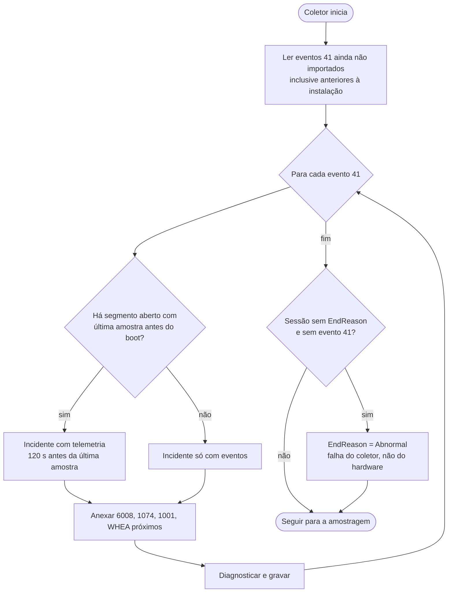
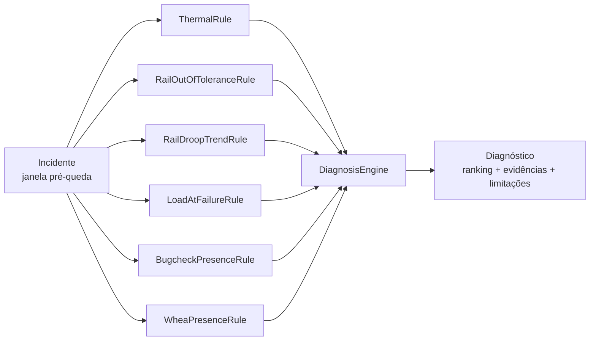

# Fluxos

Status: 🕓 planejado (Planos 02–04). Os diagramas descrevem o comportamento alvo.

## Ciclo de vida do coletor e amostragem (Plano 02)

- O `WindowsServiceLifetime` padrão não distingue *stop* de *shutdown*; o host terá um lifetime próprio que trata `OnShutdown`, *preshutdown* e `OnPowerEvent`.
- **Watchdog:** a leitura de sensores roda numa thread dedicada. Um ciclo acima de 10 s registra `SamplerStalled` e encerra o processo; as ações de recuperação do serviço o reiniciam.

## Detecção de incidentes (Plano 03)

O **Kernel-Power 41** do Log de Eventos é a fonte de verdade de que a máquina caiu ([ADR 0005](../adr/0005-event-log-as-incident-source-of-truth.md)).

## Motor de diagnóstico (Plano 04)

Cada regra é uma classe que implementa `IDiagnosticRule` e devolve evidências para uma hipótese; o motor só agrega. Nova regra = nova classe registrada, sem alterar o motor.

Tabela de regras, pesos e limitações: §6.3 do [estudo](../estudos/2026-11-24-estudo-arquitetura.md).
