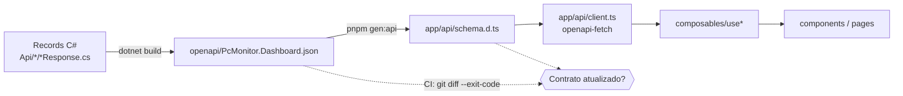
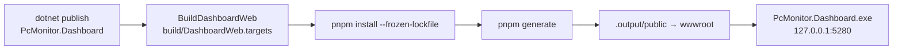

# Frontend

O painel é uma SPA Nuxt 4 + Nuxt UI em `src/PcMonitor.Dashboard.Web`, gerada como arquivos estáticos e servida pelo `PcMonitor.Dashboard` ([ADR 0007](../adr/0007-nuxt-spa-static-with-nuxt-ui.md)). Convenções de pastas: [AGENTS.md do frontend](../../src/PcMonitor.Dashboard.Web/AGENTS.md).

## Contrato da API ✅

Os DTOs existem só em C#. O TypeScript é gerado ([ADR 0008](../adr/0008-openapi-generated-typescript-contract.md)).

## Publicação ✅

`dotnet build` e `dotnet test` não precisam de Node. Rotas desconhecidas em `/api` respondem 404; qualquer outra rota serve `index.html`.
