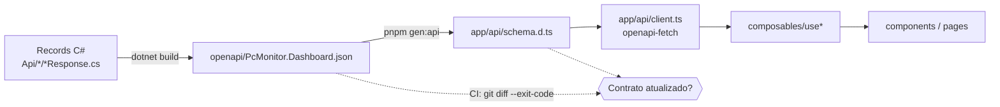
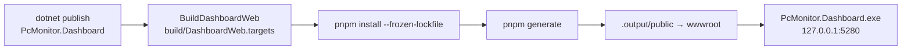
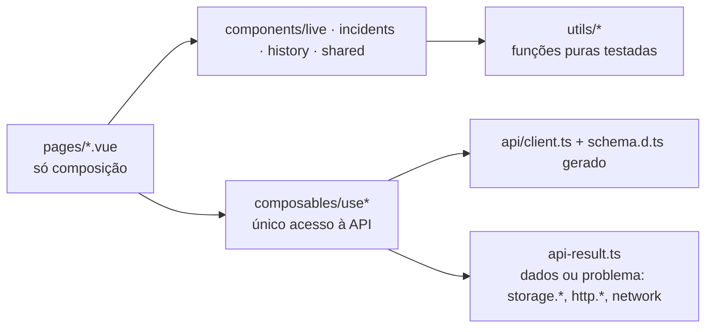

# Frontend

O painel é uma SPA Nuxt 4 + Nuxt UI em `src/PcMonitor.Dashboard.Web`, gerada como arquivos estáticos e servida pelo `PcMonitor.Dashboard` ([ADR 0007](../adr/0007-nuxt-spa-static-with-nuxt-ui.md)). Convenções de pastas: [AGENTS.md do frontend](../../src/PcMonitor.Dashboard.Web/AGENTS.md).

## Contrato da API ✅

Os DTOs existem só em C#. O TypeScript é gerado ([ADR 0008](../adr/0008-openapi-generated-typescript-contract.md)).

## Publicação ✅

`dotnet build` e `dotnet test` não precisam de Node. Rotas desconhecidas em `/api` respondem 404; qualquer outra rota serve `index.html`.

## Telas ✅

| Rota | Mostra | Dados |
|---|---|---|
| `/` Ao vivo | estado da gravação, CPU, +12 V, consumo e carga com minigráficos, tendência de 10 min, réguas das tensões com a faixa ATX, Vcore, ventoinhas, memória, últimas quedas | `useLive` (retrato + SSE), `useIncidents` |
| `/incidents` | resumo (total, 24 h, logo após ligar, em hibernação), quedas por dia, tabela | `useIncidents` |
| `/incidents/:id` | causa mais provável e confiança, placar das hipóteses, linha do tempo, os 2 min antes da queda, o que pesou, limites da análise | `useIncident` |
| `/history` | sensor × período (1 h, 24 h, 7 dias, 14 dias) na URL, mínimo/média/máximo, quedas do período | `useHistorySensors`, `useHistory`, `useHistorySelection` |

- **Faixas e limites** chegam da API (`SensorResponse.range`, `limit`, `critical`), calculados pelo C# a partir das mesmas constantes do diagnóstico. O frontend nunca repete um limiar.
- **Textos do diagnóstico:** cada `FindingCode` tem uma chave em `utils/finding-keys.ts` (`satisfies Record<FindingCode, string>`): um código novo no C# quebra o typecheck até ganhar texto em pt-BR e en. Parâmetros chegam como texto invariante e são formatados no idioma (`utils/findings.ts`).
- **Gráficos:** só via `shared/TimeSeriesChart.vue` ([ADR 0013](../adr/0013-charts-with-nuxt-ui-uchart.md)).
- **Cores:** `success`/`warning`/`error` só para status de leitura (`utils/sensor-status.ts`); séries de gráfico usam a paleta crua.
- **Layout:** variante *inset* do `USidebar` (`layouts/default.vue`): navegação sobre o fundo, recolhível até os ícones; cada página é um cartão com a barra de título e o botão do menu (`shared/Page.vue`).
- **Tema:** o escolhido pelo dono ([ADR 0015](../adr/0015-nuxt-ui-theme.md)): teal/neutral, cantos retos, Google Sans Flex, ícones Material Symbols; fontes e ícones empacotados no build.
