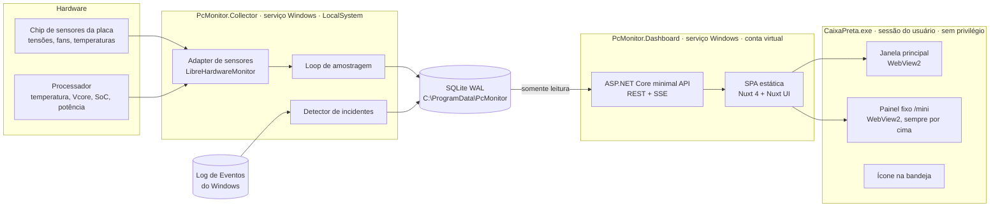
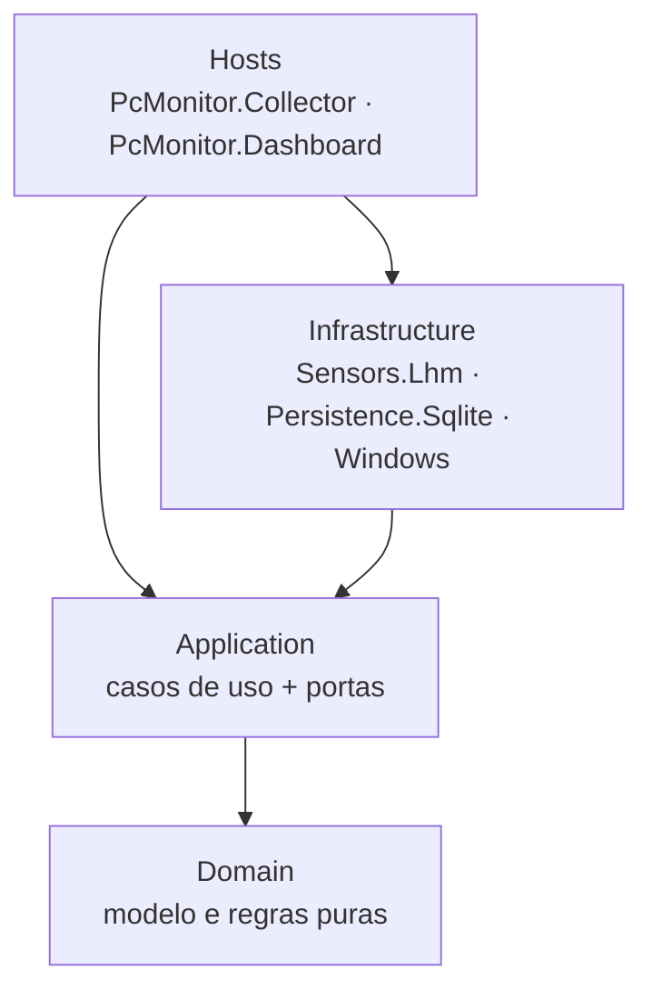

# Visão geral

## Contexto

A Caixa-Preta (nome interno PC Monitor, [ADR 0017](../adr/0017-product-identity.md)) roda numa única máquina Windows. Ela lê sensores de hardware, grava tudo num banco local e mostra os dados num painel servido na própria máquina, aberto pelo app da bandeja ou pelo navegador. Nada sai da máquina.

## Contêineres (processos)

| Processo | Privilégio | Responsabilidade | Status |
|---|---|---|---|
| Collector | LocalSystem (acesso ao driver de sensores) | Ler sensores, gravar amostras, detectar e diagnosticar incidentes | ✅ (Planos 02–04) |
| Dashboard | `NT SERVICE\PcMonitor.Dashboard` (sem privilégio, só leitura na pasta de dados) | Servir API e painel em `127.0.0.1:5280`, só leitura | ✅ (Plano 05) |
| App da bandeja (`CaixaPreta.exe`) | Usuário da sessão | Ícone na bandeja, janela com o painel e painel fixo sempre visível ([ADR 0018](../adr/0018-tray-app-webview2-mini-panel.md)) | ✅ (Plano 06) |

O app da bandeja só fala HTTP com o dashboard e não referencia nenhum projeto PC Monitor. Os três vão num instalador único ([ADR 0020](../adr/0020-inno-setup-installer.md)): `%ProgramFiles%\PcMonitor\{Collector,Dashboard,Tray,Scripts}`.

Fora da máquina do usuário há só a landing page (`src/PcMonitor.Site`): um site estático no GitHub Pages que não fala com nenhum dos processos acima ([frontend.md](frontend.md#landing-page-), [ADR 0021](../adr/0021-landing-page-and-shared-theme.md)).

Coletor e dashboard **não conversam entre si**: o banco é o contrato. Ver [ADR 0003](../adr/0003-collector-dashboard-split-least-privilege.md) e, para a API de leitura, o ao vivo por SSE e a privacidade dos eventos, [ADR 0014](../adr/0014-read-api-sse-and-event-privacy.md).

## Camadas

| Regra | Como é garantida |
|---|---|
| Dependências apontam para dentro | Referências entre projetos (compilação) |
| Domain só usa a biblioteca base do .NET | `LayerDependencyTests.Domain_references_only_the_base_class_library` |
| Application não conhece Infrastructure nem hosts | `Application_does_not_depend_on_infrastructure_or_hosts` |
| Adapters não dependem uns dos outros | `Infrastructure_adapters_do_not_depend_on_each_other` |
| Dashboard não usa os adapters de sensores e Windows | `Dashboard_does_not_depend_on_sensor_or_windows_adapters` |
| Só o adapter de sensores usa LibreHardwareMonitor | `Only_the_sensor_adapter_uses_LibreHardwareMonitor` |

Os testes ficam em `tests/PcMonitor.Architecture.Tests`.
