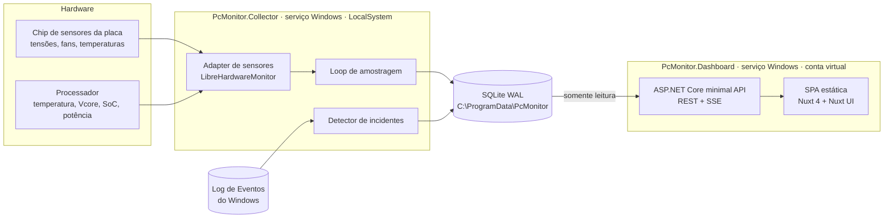
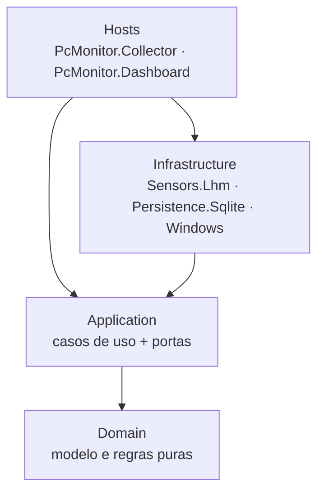

# Visão geral

## Contexto

O PC Monitor roda numa única máquina Windows. Ele lê sensores de hardware, grava tudo num banco local e mostra os dados num painel aberto no navegador da própria máquina. Nada sai da máquina.

## Contêineres (processos)

| Processo | Privilégio | Responsabilidade | Status |
|---|---|---|---|
| Collector | LocalSystem (acesso ao driver de sensores) | Ler sensores, gravar amostras, detectar incidentes | ✅ amostragem, persistência, retenção, serviço (Plano 02) · 🕓 incidentes e diagnóstico (Planos 03–04) |
| Dashboard | `NT SERVICE\PcMonitorDashboard` (sem privilégio) | Servir API e painel em `127.0.0.1:5280`, só leitura | ✅ host, `/api/health`, SPA · 🕓 dados (Plano 05) |

Os dois processos **não conversam entre si**: o banco é o contrato. Ver [ADR 0003](../adr/0003-collector-dashboard-split-least-privilege.md).

## Camadas

| Regra | Como é garantida |
|---|---|
| Dependências apontam para dentro | Referências entre projetos (compilação) |
| Domain só usa a biblioteca base do .NET | `LayerDependencyTests.Domain_references_only_the_base_class_library` |
| Application não conhece Infrastructure nem hosts | `Application_does_not_depend_on_infrastructure_or_hosts` |
| Adapters não dependem uns dos outros | `Infrastructure_adapters_do_not_depend_on_each_other` |
| Dashboard não usa os adapters de sensores e Windows | `Dashboard_does_not_depend_on_sensor_or_windows_adapters` |
| Só o adapter de sensores usa LibreHardwareMonitor | `Only_the_sensor_adapter_uses_LibreHardwareMonitor` |

Os testes ficam em `tests/PcMonitor.Architecture.Tests`.
