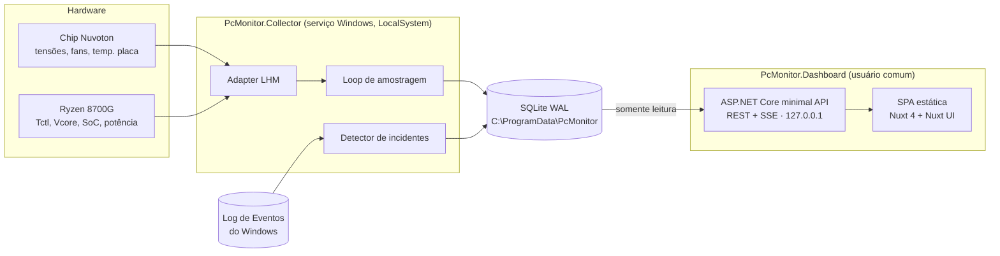
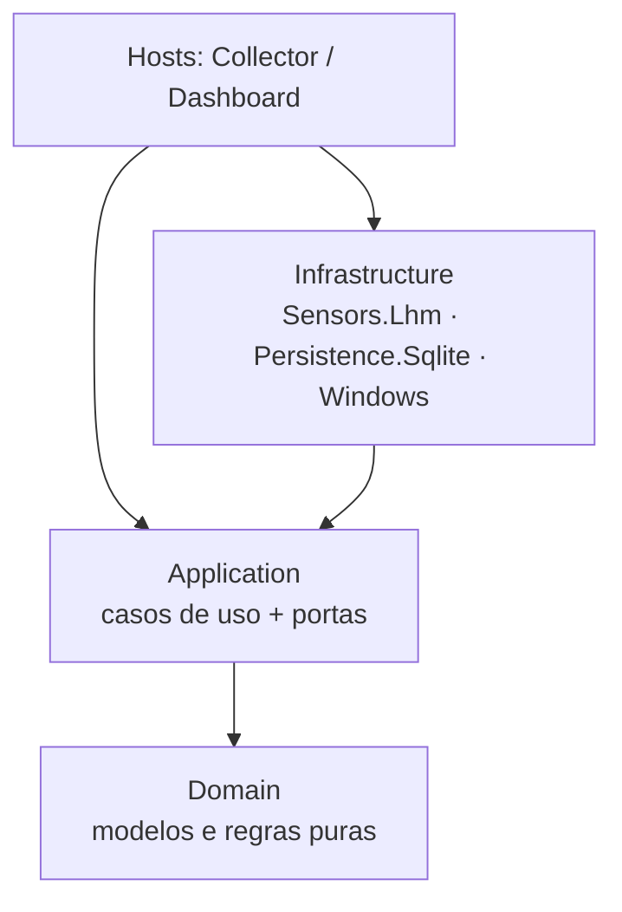
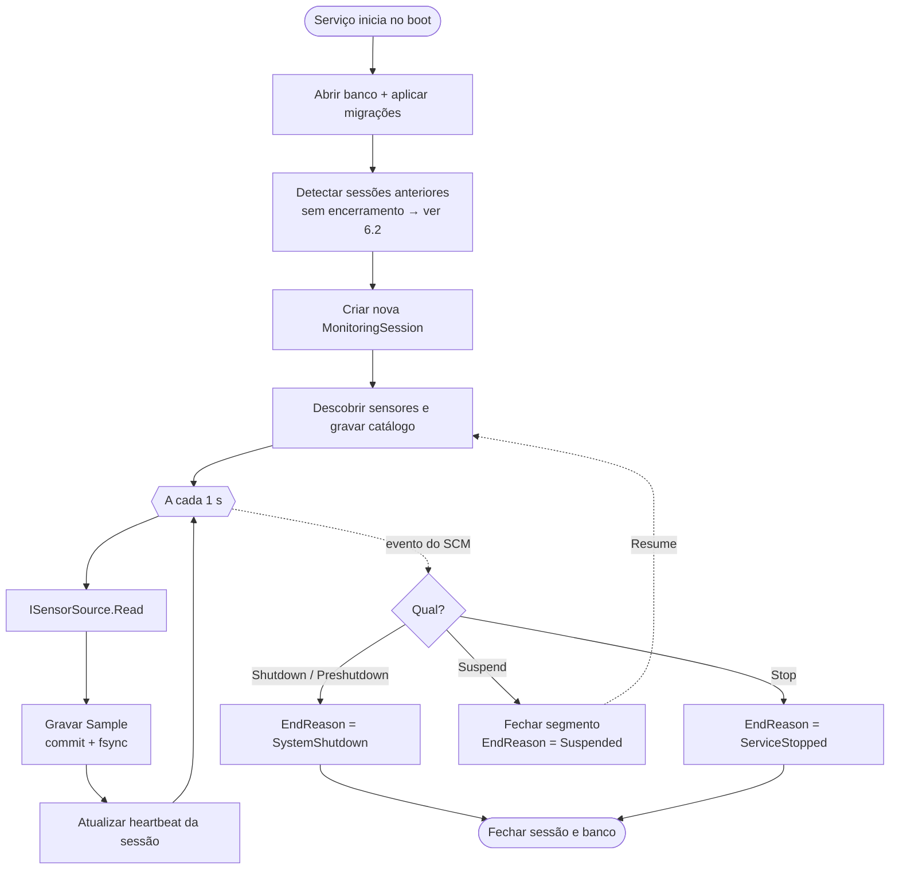
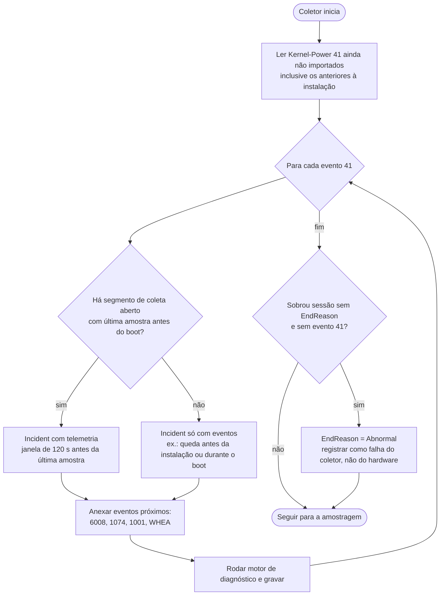
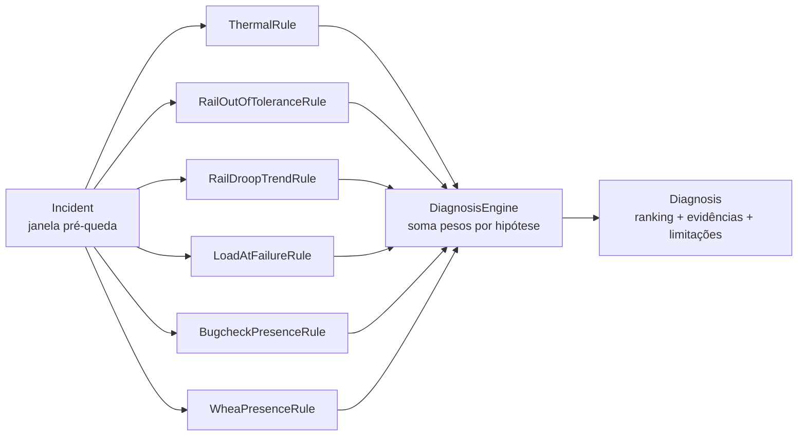
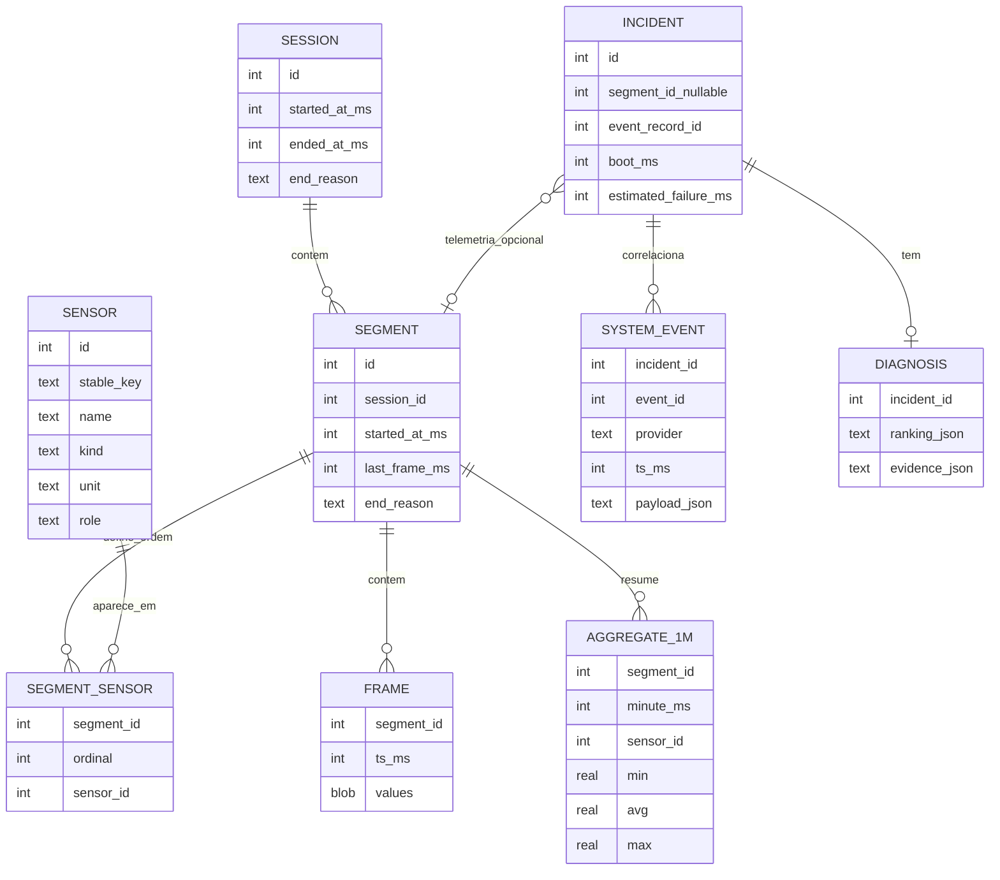

# Estudo de arquitetura — PC Monitor

> Status: **proposta para aprovação** · Data: 24/11/2026
> Nada foi construído ainda. Este documento define o quê, o porquê e o como antes do primeiro código.

---

## 1. Contexto e motivo

O desktop caiu da mesa, o gabinete amassou e a placa-mãe já tinha reparos com solda. Desde **16/11/2026** a máquina desliga e religa sozinha.

O que os logs do Windows já mostram (levantamento de 24/11):

| Evidência | Valor | O que indica |
|---|---|---|
| Kernel-Power 41 | 16 ocorrências em 9 dias, 4 só em 24/11 | Desligamento sem aviso |
| `BugcheckCode` | 0 em todas | Nenhuma tela azul registrada. Compatível com corte de energia, **mas também** com travamento seguido de reset, reset por hardware ou desligamento térmico. |
| WHEA-Logger | 0 eventos | Nenhum erro de CPU/RAM registrado. **Não inocenta** CPU/RAM: um corte apaga os registros de erro do hardware antes de o Windows gravá-los. |
| Minidumps | nenhum | Coerente com as hipóteses acima |

Uma proteção da fonte que desarma costuma deixar a máquina **desligada**. O fato de ela **religar sozinha** pesa um pouco mais para reset (linha de reset em curto, placa) do que para fonte, a menos que a BIOS esteja configurada para ligar ao voltar a energia. Isso é indício, não prova.

Hardware: ASUS TUF Gaming A620M-Plus WiFi · Ryzen 7 8700G (iGPU 780M) · 2×16 GB DDR5-4800 · BIOS 3854 · Windows 11 Pro.

**O dono não pode fazer testes físicos** (abrir, trocar peças, multímetro). O software é a principal ferramenta de diagnóstico.

**Por que construir em vez de usar HWiNFO:** o dono quer uma ferramenta própria, que faça sentido para ele, e que será publicada como código aberto. A qualidade do código é requisito: precisa resistir à revisão de um engenheiro sênior.

## 2. Objetivos, não-objetivos e anti-objetivos

### Objetivos
1. **Registrar continuamente** temperaturas, tensões, consumo, carga e fans, desde o boot, sem depender de login.
2. **Sobreviver à queda:** o que foi lido até ~1 s antes do corte precisa estar no disco.
3. **Detectar cada desligamento inesperado** no boot seguinte e gerar um **relatório do incidente** (os últimos 120 s antes da queda).
4. **Diagnóstico explicável:** para cada incidente, listar evidências a favor e contra cada hipótese (fonte, térmico, curto/placa, software), sem fingir certeza.
5. **Painel local** para ver ao vivo, navegar no histórico e abrir os incidentes.
6. Código **modular, SOLID, sem duplicação**, com testes e documentação de arquitetura com fluxogramas.

### Não-objetivos (v1)
- Controle de fans, overclock ou undervolt.
- Nuvem, contas, telemetria ou envio de dados para fora da máquina.
- Linux/macOS.
- Substituir o HWiNFO como monitor geral de hardware.
- Teste de estresse embutido (fica para a v2; ver §11).

### Anti-objetivos (falharia mesmo "funcionando")
- **O monitor causar instabilidade.** Algumas leituras de sensor (SMART de disco, controladores embarcados) podem travar ou demorar; o conjunto de sensores lidos será mínimo e configurável.
- **Gastar recursos visivelmente:** metas de < 1% de CPU, **crescimento do banco < 30 MB/dia** e **escrita física < 1 GB/dia** (≈ 0,35 TB/ano, desprezível frente aos 300–600 TBW de um SSD comum). Ver §7.
- **Diagnóstico com falsa precisão.** Um sensor lido 1×/s não vê uma queda de tensão de milissegundos. O relatório precisa dizer isso.
- **Código "esperto" e difícil de ler.** Simplicidade e responsabilidades claras vencem abstração especulativa.

## 3. Restrições e fatos técnicos verificados

| Item | Decisão / fato |
|---|---|
| Runtime | **.NET 10 (LTS)**, suporte até nov/2028. O .NET 11 (10/11/2026) é STS. SDK 10.0.404 já instalado. |
| Sensores | **LibreHardwareMonitorLib 0.9.6** (14/02/2026), MPL-2.0, tem alvo `net10.0`. |
| Driver | A lib usa o driver **PawnIO** (WinRing0 foi abandonado). A forma exata de instalação para o usuário final **precisa ser validada no spike** (§10). |
| Privilégio | Leitura de tensões e temperaturas da placa exige **administrador**. |
| Native AOT | **Não será usado.** A lib depende de `System.Management` (WMI) e reflexão, incompatíveis com AOT/trimming. Publicação: *self-contained single-file*. Corrige o que eu disse antes. |
| Chip de sensores | Placa ASUS A620 provavelmente usa Nuvoton NCT6799D (suporte "preliminar" desde LHM 0.9.2). **Validar no spike** se +12 V/+5 V/+3,3 V aparecem. |
| Licença do projeto | MIT (compatível com MPL-2.0 usada como dependência sem modificação). |

## 4. Abordagens consideradas

### A. Processo único (app de bandeja rodando como admin)
Um executável faz tudo: coleta, grava, mostra.
- ➕ Mais simples.
- ➖ Só começa a coletar depois do login; quedas durante o boot ficam de fora.
- ➖ A interface inteira roda com privilégio de administrador.

### B. Serviço coletor + painel web separado, comunicando pelo banco ⭐ **recomendada**
- **Collector:** serviço do Windows (LocalSystem), mínimo, só lê sensores e grava.
- **Dashboard:** segundo serviço, sob a conta virtual de baixo privilégio `NT SERVICE\PcMonitorDashboard`, inicia no boot e serve em `http://127.0.0.1:5280` a API e o painel em **Vue + Nuxt UI** (ver §8). O usuário só abre o navegador (atalho no menu Iniciar). Abre o banco em **somente leitura** (ver §7, "Permissões").
- ➕ Coleta desde o boot, sem login.
- ➕ Privilégio mínimo: só o coletor tem acesso ao hardware; o painel nunca escreve nada.
- ➕ Sem IPC: o SQLite em modo WAL permite leitores concorrentes; o banco é o contrato.
- ➖ Dois processos para instalar.

### C. Serviço coletor + app desktop (WPF/Avalonia) via named pipe
- ➕ Visual nativo.
- ➖ Exige protocolo IPC próprio, mais código para manter, e gráficos de série temporal em desktop .NET são pesados.
- ➖ Menos portátil para contribuidores de código aberto.

**Recomendação: B.** É a que separa melhor as responsabilidades (coletar × mostrar), aplica privilégio mínimo e não inventa protocolo.

## 5. Arquitetura (Ports & Adapters)

### 5.1 Visão de contêineres



### 5.2 Camadas e regra de dependência



- **Domain** não depende de nada (nem de `Microsoft.Extensions.*`).
- **Application** define as **portas** (interfaces) e os casos de uso; não conhece LHM, SQLite nem Windows.
- **Infrastructure** implementa as portas. Cada adapter fica num projeto próprio, para que trocar um deles não mexa nos outros.
- **Hosts** só fazem composição (DI, configuração, ciclo de vida). Nenhuma regra de negócio.
- A direção entre camadas já é garantida **na compilação** pelas referências entre projetos. O **ArchUnitNET** cobre o que referências não pegam, como um teste que falha: Domain sem `Microsoft.Extensions.*`, convenções de nome, casos de uso sem dependência de tipos concretos de Infrastructure.

### 5.3 Projetos

```
pc-monitor/
├─ src/
│  ├─ PcMonitor.Domain/                      # entidades, value objects, políticas
│  ├─ PcMonitor.Application/                 # portas, casos de uso, motor de diagnóstico
│  ├─ PcMonitor.Infrastructure.Sensors.Lhm/  # ISensorSource via LibreHardwareMonitor
│  ├─ PcMonitor.Infrastructure.Persistence.Sqlite/  # repositórios, migrações, PRAGMAs
│  ├─ PcMonitor.Infrastructure.Windows/      # leitor do Event Log, info do sistema
│  ├─ PcMonitor.Collector/                   # host: Worker Service / Windows Service
│  ├─ PcMonitor.Dashboard/                   # host: ASP.NET Core minimal API; serve a SPA gerada
│  └─ PcMonitor.Dashboard.Web/               # frontend: Nuxt 4 + Nuxt UI (TypeScript, SPA estática)
├─ tests/
│  ├─ PcMonitor.Domain.Tests/
│  ├─ PcMonitor.Application.Tests/
│  ├─ PcMonitor.Infrastructure.Persistence.Sqlite.Tests/   # integração com arquivo temporário
│  └─ PcMonitor.Architecture.Tests/          # regras de dependência entre camadas
├─ docs/
│  ├─ architecture/   # visão geral, fluxos, modelo de dados (Mermaid)
│  ├─ adr/            # decisões registradas (0001-dotnet-10-lts.md, ...)
│  └─ estudos/        # este documento
├─ scripts/           # install.ps1 / uninstall.ps1 do serviço
├─ AGENTS.md · CLAUDE.md
├─ Directory.Build.props · Directory.Packages.props · global.json · .editorconfig
├─ PcMonitor.slnx
└─ LICENSE (MIT) · README.md
```

### 5.4 Modelo de domínio (principais tipos)

| Tipo | Responsabilidade |
|---|---|
| `SensorId` | Identificador estável (ex.: `/lpc/nct6799d/voltage/0`) |
| `SensorDescriptor` | Nome, `SensorKind` (Temperature, Voltage, Power, Load, Fan, Clock), unidade, hardware de origem |
| `SensorRole` | Papel semântico usado pelo diagnóstico: `CpuTemperature`, `Rail12V`, `Rail5V`, `Rail3V3`, `Vcore`, `CpuPackagePower`, `CpuLoad`... Mapeado por configuração, porque o nome do sensor muda de placa para placa. |
| `Reading` / `Sample` | Valor de um sensor / conjunto de leituras num instante (UTC) |
| `MonitoringSession` | Uma execução do processo coletor; guarda `EndReason` |
| `SessionSegment` | Trecho contínuo de coleta dentro da sessão. Suspensão, hibernação e o *Fast Startup* do Windows abrem um novo segmento, porque o serviço não é parado nesses casos. |
| `EndReason` | `ServiceStopped`, `SystemShutdown`, `Suspended`, `Abnormal` |
| `Incident` | **Evento Kernel-Power 41** (fonte de verdade) + eventos correlacionados + janela de telemetria pré-queda, **quando houver** |
| `RailTolerance` | Política ATX: 12 V ±5% (11,40–12,60), 5 V ±5% (4,75–5,25), 3,3 V ±5% (3,135–3,465) |
| `Hypothesis` / `Evidence` / `Diagnosis` | Hipóteses (PSU, Thermal, BoardOrShort, Software) com evidências pesadas e explicadas |

### 5.5 Portas (Application)

| Porta | Implementação |
|---|---|
| `ISensorSource` — descobre sensores e lê um `Sample` | `LhmSensorSource` |
| `ISampleWriter` / `ISampleReader` | SQLite (escritor no coletor, leitor no painel) |
| `ISessionRepository` | SQLite |
| `IIncidentRepository` | SQLite |
| `ISystemEventLog` — Kernel-Power 41, 6008, 1074, BugCheck 1001, WHEA | `WindowsEventLogReader` |
| Tempo | `TimeProvider` nativo do .NET (testável com `FakeTimeProvider`), sem interface própria |

Leitura e escrita separadas (ISP): o painel nem enxerga a interface de escrita.

## 6. Fluxos

### 6.1 Ciclo de vida do coletor e amostragem



O motivo da parada **não é exposto** pelo `WindowsServiceLifetime` padrão (stop e shutdown chamam o mesmo `StopApplication()`). Por isso o host do coletor terá uma subclasse própria, `PcMonitorServiceLifetime`, que sobrescreve `OnShutdown`, aceita *preshutdown* e trata `OnPowerEvent` (suspensão/retomada).

**Watchdog:** a leitura da LibreHardwareMonitor é síncrona, passa pelo driver e não pode ser cancelada. A amostragem roda numa thread dedicada. Se um ciclo passar de 10 s, o watchdog registra `SamplerStalled` no Event Log e encerra o processo com código de erro; as **ações de recuperação do serviço** (configuradas pelo `install.ps1`) reiniciam o coletor. Isolamento real por reinício de processo, em vez de um timeout que só finge cancelar.

### 6.2 Detecção de incidente

O **Event Log é a fonte de verdade** de que a máquina caiu. Uma sessão sem `EndReason` sozinha não basta: o próprio coletor pode ter morrido, ou o Windows pode tê-lo encerrado por demora no desligamento.



Importar os eventos 41 antigos coloca as 16 quedas já ocorridas no painel desde o primeiro dia, ainda sem telemetria, mas úteis para ver o padrão de horários e intervalos.

### 6.3 Motor de diagnóstico

Cada regra é uma classe que implementa `IDiagnosticRule` e devolve zero ou mais `Evidence` para uma hipótese. O motor só agrega. Nova regra = nova classe registrada no DI, sem tocar no motor (OCP).



Regras iniciais (heurísticas, com pesos configuráveis):

| Regra | Sinal | Aponta para |
|---|---|---|
| `ThermalRule` | CPU ≥ 90 °C ou subida rápida nos últimos 30 s | Térmico (cooler deslocado) |
| `RailOutOfToleranceRule` | 12 V / 5 V / 3,3 V fora da faixa ATX | Fonte |
| `RailDroopTrendRule` | Rail caindo junto com aumento de carga | Fonte |
| `LoadAtFailureRule` | Carga alta na queda → fonte/térmico; carga baixa e sinais normais → curto/placa | Fonte · Térmico · Placa |
| `BugcheckPresenceRule` | BugcheckCode ≠ 0 ou dump presente → forte para software/driver. **Ausência** de bugcheck: evidência **fraca**, porque é compatível com corte, reset, travamento e desligamento térmico. | Software/driver |
| `WheaPresenceRule` | Evento WHEA perto da queda. A ausência não pesa contra CPU/RAM. | CPU/RAM |

Todo relatório termina com a seção **Limitações**: a taxa de amostragem não vê transientes, o sensor de 12 V tem erro de ±2–3%, sinais normais não inocentam a fonte e um incidente sem telemetria só tem a evidência do Event Log.

## 7. Persistência

- **SQLite** via `Microsoft.Data.Sqlite` + **Dapper** (mapeamento fino, SQL explícito). EF Core descartado: esconderia os PRAGMAs de durabilidade, que aqui são o ponto central.
- `journal_mode=WAL`, **`synchronous=FULL`**: cada commit vai ao disco.
- Migrações: arquivos `.sql` embutidos, versionados por `PRAGMA user_version`, aplicados por um migrador pequeno e testado.

### Uma linha por amostra, não por leitura

Gravar uma linha por sensor por segundo (~2,6 M linhas/dia) daria 80–150 MB/dia e, com um commit por segundo, ~1 GB/dia de escrita. A escolha é **uma linha por instante**:

- `FRAME(segment_id, ts_ms, values BLOB)`: os valores são um vetor de `float32` na ordem definida pelo **catálogo de sensores do segmento** (`SEGMENT_SENSOR(segment_id, ordinal, sensor_id)`).
- ~30 sensores → ~120 bytes de valores por segundo → **~15–20 MB/dia** no banco.
- Codificar e decodificar o vetor é responsabilidade de uma única classe (`FrameCodec`) com testes próprios. Nenhum outro lugar conhece o formato.
- Trade-off aceito: consultar um sensor isolado exige decodificar o quadro na aplicação, em vez de um `WHERE sensor_id = ?`. Para janelas de minutos ou horas, isso é barato.

**Escrita física:** cada commit grava ~1–2 páginas de 4 KB no WAL, mais o checkpoint: na ordem de 0,7–1 GB/dia. Fica dentro da meta da §2 e é desprezível para a vida útil do SSD.

### Retenção (entra na v1, fase 2)
Quadros brutos por 14 dias; agregados de 1 minuto (mín/méd/máx por sensor) indefinidamente; **janelas de incidente nunca são apagadas**. A limpeza roda uma vez por hora no coletor.

### Permissões e o painel em somente leitura
Um leitor de banco WAL precisa dos arquivos `-wal` e `-shm`. Sem permissão de escrita, o SQLite (≥ 3.22) só abre o banco se eles já existirem, e o SQLite os apaga quando a última conexão fecha. Solução:

1. O coletor ativa **WAL persistente** (`SQLITE_FCNTL_PERSIST_WAL`), então os arquivos não são apagados ao fechar.
2. ACL de `C:\ProgramData\PcMonitor\`: SYSTEM com controle total; `NT SERVICE\PcMonitorDashboard` com **leitura** no banco e no `-wal` e **escrita só no `-shm`** (memória compartilhada de índice, sem dados).
3. O painel abre com `Mode=ReadOnly`, e o código dele só enxerga `I*Reader`.

O comportamento exato (persistência do `-shm`, desempenho do modo somente leitura) **é validado num teste de integração na fase 2**, antes do painel. Se não se confirmar, o plano B (ADR) é o coletor expor um endpoint somente leitura num named pipe com ACL.

### Durabilidade: o que dá e o que não dá para testar
- **Testável:** consistência após o processo morrer no meio de uma escrita (o teste mata o processo e roda `PRAGMA integrity_check`).
- **Não testável sem hardware de injeção de falha:** a garantia contra queda de energia. Ela vem do contrato do SQLite com `synchronous=FULL` e fica documentada num ADR, sem um teste que fingiria provar.



## 8. Painel

Páginas:
1. **Ao vivo:** valores atuais com a faixa segura e gráficos dos últimos 10 min.
2. **Incidentes:** lista de quedas; cada uma abre a linha do tempo dos 120 s finais, os eventos do Windows e o diagnóstico com as evidências.
3. **Histórico:** escolher sensores e período.

```
┌ PC Monitor ─────────────── Ao vivo · Incidentes · Histórico ┐
│ CPU 62 °C ▁▂▃▃▄   12 V 12,08 ✓   5 V 5,02 ✓   3,3 V 3,31 ✓ │
│ Carga 34 %        Potência 48 W   Vcore 1,21 V             │
├─────────────────────────────────────────────────────────────┤
│ Incidente #16 · 24/11 13:54:21 (±1 s)                       │
│  ▸ Mais provável: Curto/placa (evidência moderada)          │
│    + carga 8% e temperaturas normais até o último segundo   │
│    + rails dentro da faixa ATX                              │
│    − não exclui transiente da fonte (ver Limitações)        │
└─────────────────────────────────────────────────────────────┘
```

### Frontend: Vue + Nuxt UI (decisão do dono)

**Requisito explícito: a interface precisa ser bonita.** Antes da fase 5 vêm mockups visuais para aprovação; o esboço acima é só a estrutura.

| Item | Escolha | Motivo |
|---|---|---|
| Framework | **Nuxt 4** em modo SPA (`ssr: false`) gerado como **estático** (`nuxt generate`) | Rotas por arquivo, auto-imports e o módulo oficial do Nuxt UI, **sem Node rodando na máquina**: o ASP.NET Core serve os arquivos gerados. |
| Componentes | **Nuxt UI v4** (v4.9 em jun/2026; gratuito, inclui os antigos componentes Pro e os layouts de dashboard) | Pedido do dono; visual consistente, tema claro/escuro pronto, acessível (Reka UI por baixo). |
| Gráficos | **Unovis** (`@unovis/vue`) | Biblioteca usada no template oficial de dashboard do Nuxt UI (confirmar no scaffold), visual coerente com os componentes. Uma única biblioteca de gráficos no projeto. Plano B: uPlot, se o histórico longo ficar lento. |
| Tema | Modo escuro como padrão, claro disponível; cores semânticas para "dentro da faixa / atenção / fora da faixa" definidas uma vez no `app.config.ts` | Um só lugar para a paleta. |
| Idioma da UI | `@nuxtjs/i18n` com **pt-BR** (padrão) e **en** | Textos centralizados desde o início; adicionar idioma depois é só um arquivo. |
| Tempo real | **Server-Sent Events** nativo do ASP.NET Core 10 (`TypedResults.ServerSentEvents`), consumido por um composable `useLiveSamples()` | Fluxo de mão única, mais simples que WebSocket/SignalR; reconexão automática do navegador. |
| Contrato da API | OpenAPI gerado pelo ASP.NET Core (`Microsoft.AspNetCore.OpenApi`) → tipos TypeScript com **openapi-typescript** → cliente **openapi-fetch** | **Os DTOs existem uma vez só**, em C#. O TypeScript é gerado; o CI falha se o arquivo gerado estiver desatualizado. O tipo do evento SSE é publicado no documento por um transformer (detalhe para o construtor). |
| Organização | `pages/` (só composição) · `components/` por domínio (`live/`, `incidents/`, `history/`, `shared/`) · `composables/` (estado e acesso à API) · `utils/` (formatação pura) | Componentes não chamam a API diretamente; passam por composables. Mesma separação de responsabilidades do backend. |
| Qualidade | TypeScript `strict` + `vue-tsc` (`nuxi typecheck`) · `@nuxt/eslint` · **Vitest** + `@nuxt/test-utils` para composables e componentes · Playwright para um fluxo ponta a ponta do painel | |
| Ferramentas | **pnpm**, Node **24 LTS** fixado em `.nvmrc` e `packageManager` | Só para desenvolver e compilar. |
| Integração no build | Um alvo MSBuild no `PcMonitor.Dashboard.csproj` roda `pnpm generate` no `dotnet publish` e copia `.output/public` para `wwwroot` | Um comando gera o pacote inteiro. Em desenvolvimento, `nuxt dev` com proxy para a API. |

**Alternativa descartada:** Nuxt com SSR rodando em Node. Exigiria um runtime Node instalado e um terceiro processo na máquina, sem ganho para um painel local.

## 9. Engenharia e qualidade

| Área | Escolha |
|---|---|
| Solução | `PcMonitor.slnx` (formato novo) |
| Pacotes | **Central Package Management** (`Directory.Packages.props`): uma versão por pacote no repositório |
| Build | `Directory.Build.props`: `Nullable=enable`, `TreatWarningsAsErrors=true`, `AnalysisLevel=latest-recommended`, `EnforceCodeStyleInBuild=true` |
| Estilo | `.editorconfig` + `dotnet format --verify-no-changes` no CI |
| SDK | `global.json` fixa o 10.0.4xx |
| Hosting | `Microsoft.Extensions.Hosting` + `.WindowsServices`; Options com `ValidateOnStart` |
| Logs | `Microsoft.Extensions.Logging` → Event Log do Windows (coletor) e console (painel). Sem Serilog: os dados de verdade ficam no SQLite. |
| Testes | xUnit v3 · **Shouldly** (FluentAssertions v8 virou licença comercial) · **NSubstitute** só quando um fake escrito à mão não bastar · `Microsoft.Extensions.TimeProvider.Testing` |
| Arquitetura | **ArchUnitNET**: regras de camada como testes |
| Duplicação | **jscpd** no CI com limiar baixo, cobrindo C# e TypeScript/Vue |
| CI | GitHub Actions em `windows-latest`: restore → build → format → test (.NET) · lint → typecheck → test → verificação do cliente OpenAPI gerado (frontend) · jscpd |

### Mapa SOLID

| Princípio | Onde aparece |
|---|---|
| **S** | Cada caso de uso é uma classe; cada adapter, um projeto; hosts só compõem |
| **O** | Regras de diagnóstico plugáveis; novas fontes de sensor sem mudar a Application |
| **L** | Fakes de teste e adapters reais trocáveis pelas mesmas portas |
| **I** | `ISampleWriter` separado de `ISampleReader`; o painel nunca vê escrita |
| **D** | Application depende de portas; Infrastructure depende da Application, nunca o contrário |

### Documentação para LLMs
- `AGENTS.md` na raiz (visão geral, comandos, convenções) e **um por projeto** em `src/*` e `tests/*` (responsabilidade, o que pode e não pode depender, como testar).
- Cada pasta com `AGENTS.md` tem um `CLAUDE.md` de uma linha: `@AGENTS.md`. Uma fonte de verdade, sem conteúdo duplicado.
- `docs/architecture/` com os diagramas Mermaid deste estudo, mantidos atualizados; `docs/adr/` registra cada decisão com contexto e alternativas.

### Idioma (decisão minha, ajustável)
Código, identificadores e commits em **inglês** (padrão para código aberto); documentação em **português**; README bilíngue.

## 10. Riscos e validação antes do produto (spike)

O primeiro passo do plano é um **spike descartável de ~1 h** que roda a LibreHardwareMonitorLib como admin nesta máquina e lista todos os sensores. Ele responde:

1. O driver PawnIO instala e carrega? Como o usuário final faria isso?
2. Os rails **+12 V, +5 V e +3,3 V** aparecem? Os valores fazem sentido?
3. Tctl/Tdie, Vcore, SoC e a potência do 8700G aparecem?
4. Quanto tempo leva uma leitura completa? Algum sensor trava?

**Ponto de decisão do spike:**

| Resultado | O que acontece |
|---|---|
| Tudo aparece | Segue o plano. |
| Sem +12 V/+5 V/+3,3 V, mas temperatura e carga OK | **Segue**, com as regras de rail desligadas. O app ainda separa térmico × carga × "caiu parado", e o relatório diz que a fonte não pôde ser avaliada. |
| PawnIO não carrega ou nenhum sensor da placa | **Para**, e voltamos a conversar antes de construir: sem sensores, sobra só o Event Log. |

| Risco | Mitigação |
|---|---|
| Suporte "preliminar" ao NCT6799D | Spike; mapeamento de `SensorRole` por configuração |
| Antivírus marcar o driver | PawnIO é assinado; documentar no README |
| Corrupção do banco | WAL + `synchronous=FULL`; teste de consistência após matar o processo (ver §7) |
| Coletor travar numa leitura | Thread dedicada + watchdog que reinicia o processo (§6.1); hardware de risco (storage, rede) desligado por padrão |
| *Fast Startup* e suspensão confundirem as sessões | Segmentos (§5.4) e eventos de energia (§6.1) |

## 11. Roadmap

| Fase | Entrega |
|---|---|
| 0 | Spike de sensores (descartável) |
| 1 | Scaffold completo **antes de qualquer funcionalidade** (decisão do dono: qualidade primeiro): solução e camadas, build e analisadores, frontend Nuxt com lint/typecheck/testes, pipeline OpenAPI → TypeScript, CI, AGENTS/CLAUDE, docs de arquitetura, ADRs |
| 2 | Coletor: sensores → SQLite, sessões e segmentos, watchdog, retenção, serviço instalável; teste de permissões do modo somente leitura |
| 3 | Importação de eventos 41 + detecção e correlação de incidentes |
| 4 | Motor de diagnóstico + relatório |
| 5 | Mockups visuais aprovados pelo dono → painel (ao vivo, incidentes, histórico) |
| v2 | Teste de carga controlado com corte automático por temperatura; instalador |

O teste de carga ficou para a v2 de propósito: forçar uma placa danificada sem saber antes como ela se comporta parada seria arriscado.

## 12. Deixado para quem for construir

- Nomes exatos de classes e métodos que não aparecem aqui.
- Pesos iniciais das regras de diagnóstico (ajustados com os dados reais dos primeiros incidentes).
- Nada do visual do painel: ele será decidido com o dono por mockups antes da fase 5.
- Formato das mensagens de log.
